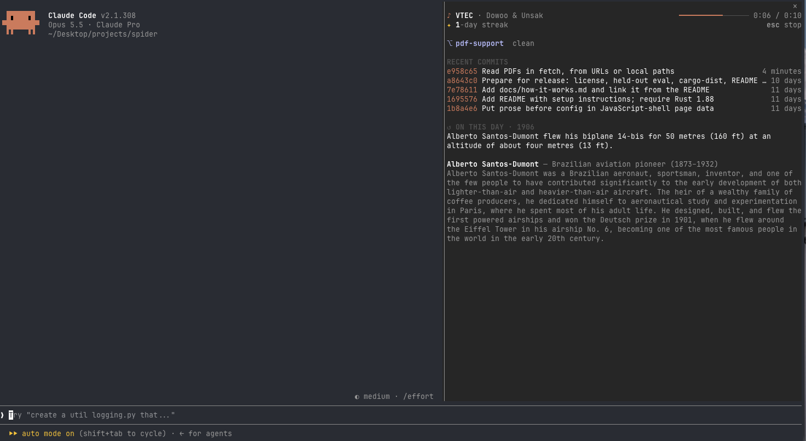

# startup-song 🎵

A Claude Code plugin that plays a few seconds of a random song every time you start Claude Code.



- Rotates through genres, one per session: **pop → hip hop → retro hits → pop …**
- For each one, it searches the [iTunes Search API](https://performance-partners.apple.com/search-api) (free, no key) and plays a random song from the **top 10** results.
- Shows a startup card above the prompt while it plays:
  - **Coding streak**: days in a row you've started Claude Code
  - **Repo status**: branch, changed files, ahead/behind, last commit
  - **On this day**: one event from [Wikipedia's on-this-day feed](https://en.wikipedia.org/api/rest_v1/) (grim ones skipped)
- The card goes away when the song ends. Press **Esc** at an empty prompt to stop it early. `/today` opens the card again.
- Uses **zero tokens**: no model call, just two web requests, two local `git` commands and an audio clip.

Audio is Apple's official 30-second preview of each track; nothing is downloaded or stored.

## Install

```
/plugin install startup-song --marketplace heyyviv/claude-boot-beats
```

Or try it from a local copy:

```
claude --plugin-dir ./claude-startup-song
```

## Settings

Change these in `/config`:

| Setting | Default | What it does |
|---|---|---|
| `genres` | `pop, hip hop, retro hits` | Comma-separated search words, used in turn |
| `seconds` | `10` | How long to play (max 30) |

## Requirements

- macOS (playback uses `afplay`). On Linux/Windows the plugin stays silent.
- Internet at startup. Offline, it simply plays nothing.
